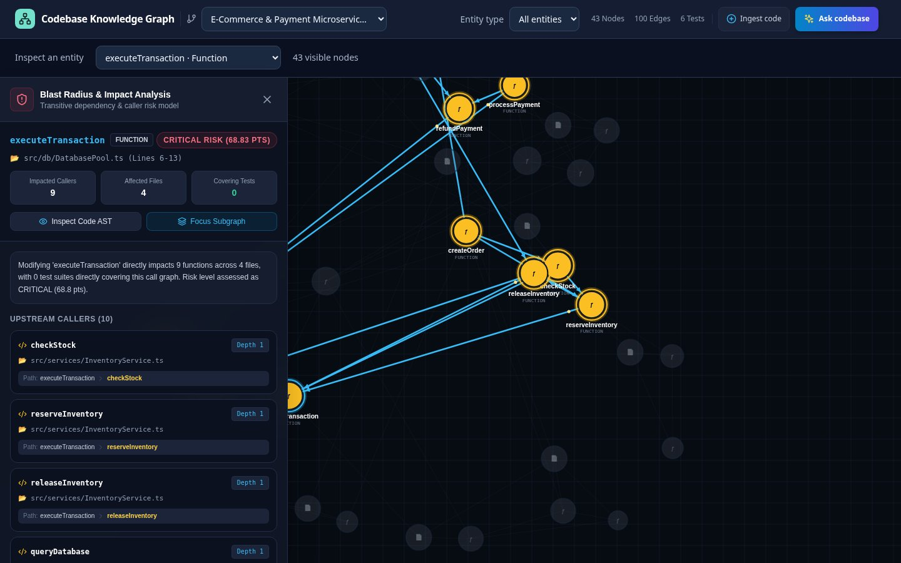

# Codebase Knowledge Graph

Codebase Knowledge Graph turns source files into an interactive map of functions, classes, imports, calls and test relationships. Use it to explore an unfamiliar repository and estimate the impact of changing a symbol.

## Quick start

Use Node.js 22 or newer.

~~~sh
npm ci
npm run dev
~~~

Open http://localhost:3000. The GraphQL gateway runs at http://localhost:4000/graphql. Two built-in sample repositories let you explore the application without a Neo4j instance, provider key, or private source code.

1. Pick a sample repository and choose an entity type.
2. Select an entity in the graph or use the keyboard-accessible entity picker.
3. Inspect upstream relationships, impacted files and linked tests.
4. Open **Ask codebase** and try “What breaks if I change executeTransaction?”
5. Use **Ingest code** to inspect a source file you are authorized to share. The application selects the resulting graph automatically.

## Features and architecture

| Component | Role |
| --- | --- |
| Next.js, React, TypeScript and Tailwind | Graph workspace, entity filtering, change-impact inspector, query drawer and code viewer |
| Express and Apollo GraphQL | Serves repository metadata, graphs, search, ingestion and impact reports |
| TypeScript ingestion engine | Extracts symbols and relationships using regex-based heuristics. Supports TypeScript, JavaScript and Python with limited generic extraction for other file types |
| In-memory graph | Powers the web demo. Custom web ingests are lost when the gateway restarts |
| Neo4j driver and ingestion CLI | Supports optional graph persistence through the CLI. The gateway reports connectivity separately |
| Question planner | Uses built-in rules to query the loaded graph and displays illustrative Cypher |

The browser renders up to 300 nodes from each filtered view. Reports can traverse the full loaded repository. The first impact report indexes nodes and relationships. Later reports reuse that index and examine the relevant adjacency lists.

### Optional Neo4j

Run docker compose up -d neo4j and set the gateway connection details from .env.example if you use different values. For native local development, place gateway overrides in services/api-gateway/.env and set NEXT_PUBLIC_GRAPHQL_ENDPOINT in packages/web/.env.local when the API endpoint differs from the default. Inspect available graph import commands with npm run ingest -- --help.

The development gateway is designed for a single trusted workspace. Decide on authentication, repository isolation and a persistent store before accepting source from multiple users.

## Build and test

~~~sh
npm run build
npm test
~~~

The tests cover GraphQL startup and sample repository selection in addition to cycles, depth zero, affected tests, unknown repositories and graph edge consistency after truncation.

## Portfolio media

| Capture | What to show |
| --- | --- |
| Workspace screenshot | A sample repository with an inspected function and its impact report |
| Demo clip | Repository selection, entity picker, call dependencies and one built-in query |

### 35-second demo

| Time | Screen | Narration |
| --- | --- | --- |
| 0–7s | Open the payments sample | “I built an interactive map for understanding a codebase before changing it.” |
| 7–18s | Select a function with the entity picker | “Choosing a function surfaces its callers, the files it could affect and tests linked to the graph.” |
| 18–29s | Open Ask codebase and ask about executeTransaction | “The built-in query planner gives me a structured answer from the same graph.” |
| 29–35s | Return to the highlighted network | “I can use that evidence to decide what to inspect and test next.” |

Record at 1440 × 900. Keep the repository name visible, pause on the result and add captions. Use the public sample so the recording contains no private source.
