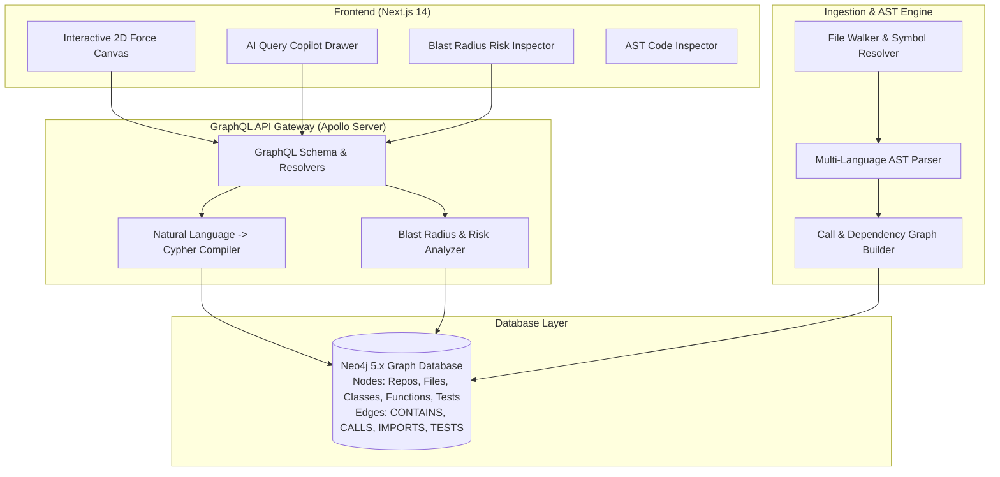

# 🕸️ Codebase Knowledge Graph

> **An AI-Queryable AST & Call Graph Intelligence Engine**  
> Ingests repositories, parses AST structures and call graphs into **Neo4j**, exposes a **GraphQL API**, and uses an **LLM-powered Cypher engine** to answer natural language architecture, blast radius, and dependency questions.

---

## 🌟 Key Highlights

- **Multi-Language AST & Call Graph Parsing**: Extracts `Functions`, `Classes`, `Modules`, `Files`, `Imports`, `Calls`, and `Tests` across TypeScript, JavaScript, Python, and Go.
- **Neo4j Graph Database**: Full property graph model with optimized Cypher queries, transitive blast-radius traversals (`[:CALLS*1..5]`), APOC path algorithms, and an in-memory high-speed fallback driver.
- **Apollo GraphQL API Gateway**: Type-safe GraphQL schema for graph querying (`graphData`), impact analysis (`blastRadius`), repository statistics (`stats`), and natural language AI queries (`askCodebase`).
- **AI-Powered Natural Language ➔ Cypher Compiler**: Translates questions like *"What breaks if I change `processPayment`?"* or *"Show all callers of `AuthService`"* into executable Cypher queries + contextual blast-radius risk explanations + highlighted visual subgraphs.
- **Interactive Visual Canvas**: 2D force-directed physics canvas with real-time node dragging, clustering, risk heatmaps, AST code inspector, and dynamic subgraph illumination.
- **Cloud-Native DevOps**: Production Docker Compose, Kubernetes Helm Charts (with HPA, StatefulSet, and Ingress), and GitHub Actions CI/CD pipeline.

---

## 🏗️ Architecture Overview



---

## 📊 Graph Data Model

### Node Labels
| Label | Description | Key Properties |
|---|---|---|
| `:Repository` | Repository entity | `id`, `name`, `branch`, `url`, `totalFiles`, `totalFunctions` |
| `:File` | Source code file | `path`, `extension`, `language`, `lineCount`, `exports` |
| `:Class` | Class or Interface definition | `name`, `isExported`, `extendsClass`, `methods` |
| `:Function` | Function or Class Method | `name`, `signature`, `cyclomaticComplexity`, `blastRadiusWeight` |
| `:Test` | Test suite or test case | `name`, `testFramework`, `testType`, `targetSymbolNames` |

### Relationships
- `(:Repository)-[:CONTAINS]->(:File)`
- `(:File)-[:DEFINES]->(:Class|Function)`
- `(:Class)-[:HAS_METHOD]->(:Function)`
- `(:Class)-[:EXTENDS]->(:Class)`
- `(:File)-[:IMPORTS]->(:File)`
- `(:Function)-[:CALLS {line: Int}]->(:Function)`
- `(:Test)-[:TESTS]->(:Function|Class|File)`

---

## ⚡ Quick Start

### 1. Install Monorepo Dependencies
```bash
npm install
```

### 2. Start Local Development
Runs the Apollo GraphQL Gateway (`http://localhost:4000/graphql`) and Next.js Web UI (`http://localhost:3000`):
```bash
npm run dev
```

### 3. Run with Docker Compose (Includes Neo4j 5.x)
```bash
docker compose up -d
```
- **Web UI:** [http://localhost:3000](http://localhost:3000)
- **GraphQL Gateway:** [http://localhost:4000/graphql](http://localhost:4000/graphql)
- **Neo4j Browser:** [http://localhost:7474](http://localhost:7474) (user: `neo4j`, pass: `codebase_kg_secret_password`)

---

## 🚀 Deploy to Kubernetes (EKS / Minikube)

```bash
# Lint and test Helm chart
helm lint infra/k8s/helm/codebase-kg

# Deploy with Helm
helm upgrade --install codebase-kg infra/k8s/helm/codebase-kg \
  --namespace codebase-kg \
  --create-namespace \
  --values infra/k8s/helm/codebase-kg/values.yaml
```

---

## 💬 Example Natural Language AI Queries

- **Blast Radius Analysis:**  
  *"What breaks if I change `processPayment`?"*  
  *(Generates Cypher for upstream transitive callers up to depth 3, calculates risk score, and maps affected test suites)*
- **Call Graph Discovery:**  
  *"Show me every place `chargeCard` is called"*  
  *(Generates incoming `CALLS` Cypher and isolates the caller nodes)*
- **Test Coverage Mapping:**  
  *"Which tests cover `OrderService`?"*  
  *(Traverses `TESTS` edges and reports unit/integration suites)*
- **Architectural Hotspots:**  
  *"Which functions have the highest cyclomatic complexity and risk?"*  
  *(Queries PageRank and complexity indices to highlight structural risk centers)*

---

## 📁 Repository Structure

```
├── services/
│   ├── ingestion-engine/   # Multi-language AST parser, symbol resolution, Neo4j batch ingester
│   └── api-gateway/        # Apollo GraphQL server, AI Cypher compiler, blast radius engine
├── packages/
│   └── web/                # Next.js 14 interactive knowledge graph visualizer & AI copilot
├── infra/
│   └── k8s/helm/           # Kubernetes Helm charts (Neo4j StatefulSet, API Deployments, Ingress, HPA)
├── .github/workflows/      # GitHub Actions CI/CD workflows
├── docker-compose.yml      # Local container orchestration
└── package.json            # Monorepo workspaces
```
